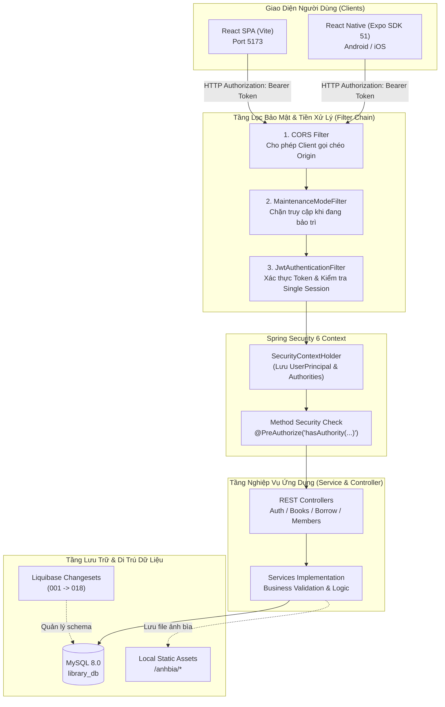
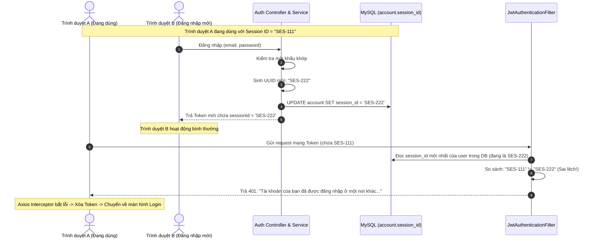

# TÀI LIỆU TOÀN DIỆN VỀ BẢO MẬT & KIẾN TRÚC HỆ THỐNG
> **Dự án:** Hệ Thống Quản Lý Thư Viện (Library Management System)  
> **Phiên bản:** 1.0.0 | **Ngày hoàn thiện:** 10/2026  
> **Ngôn ngữ & Nền tảng:** Java 21 · Spring Boot 3.2.5 · Spring Security 6 · React Vite · React Native Expo · MySQL · Liquibase

---

## MỤC LỤC
1. [Tổng Quan Kiến Trúc Tổng Thể](#1-tổng-quan-kiến-trúc-tổng-thể)
2. [Vòng Đời Của Một Request (Request Lifecycle)](#2-vòng-đời-của-một-request-request-lifecycle)
3. [Cơ Chế Xác Thực & Quản Lý Token (JWT Architecture)](#3-cơ-chế-xác-thực--quản-lý-token-jwt-architecture)
4. [Bảo Mật Đăng Nhập 1 Phiên Duy Nhất (Single Active Session)](#4-bảo-mật-đăng-nhập-1-phiên-duy-nhất-single-active-session)
5. [Cơ Chế Phân Quyền Chi Tiết (RBAC & Granular Permissions)](#5-cơ-chế-phân-quyền-chi-tiết-rbac--granular-permissions)
6. [Bộ Lọc Chế Độ Bảo Trì Toàn Hệ Thống (Maintenance Mode Filter)](#6-bộ-lọc-chế-độ-bảo-trì-toàn-hệ-thống-maintenance-mode-filter)
7. [Bảo Mật Giao Tiếp Mạng & Phòng Chống Tấn Công (Network & API Security)](#7-bảo-mật-giao-tiếp-mạng--phòng-chống-tấn-công-network--api-security)
8. [Bảo Mật Dữ Liệu Tải Lên (File Upload Security)](#8-bảo-mật-dữ-liệu-tải-lên-file-upload-security)
9. [Cơ Chế Bảo Mật Nghiệp Vụ Mượn Trả & Phạt Trễ Hạn](#9-cơ-chế-bảo-mật-nghiệp-vụ-mượn-trả--phạt-trễ-hạn)
10. [Xử Lý Lỗi Tập Trung & Bảo Mật Ngoại Lệ (Exception Handling)](#10-xử-lý-lỗi-tập-trung--bảo-mật-ngoại-lệ-exception-handling)
11. [Bảng Tra Cứu Các Tệp Cốt Lõi Trong Hệ Thống](#11-bảng-tra-cứu-các-tệp-cốt-lõi-trong-hệ-thống)

---

## 1. Tổng Quan Kiến Trúc Tổng Thể

Hệ thống được thiết kế theo mô hình **Client - Server phi trạng thái (Stateless RESTful Architecture)** với khả năng phục vụ đồng thời cho 2 nền tảng Client (Web SPA và Mobile App):



---

## 2. Vòng Đời Của Một Request (Request Lifecycle)

Mọi HTTP Request gửi từ trình duyệt Web hoặc App di động đều bắt buộc phải trải qua đường ống nghiêm ngặt gồm 6 trạm kiểm soát:

```
Request từ Client
   │
   ▼
[Trạm 1: CORS Filter] ───────────► Chặn nếu Origin không hợp lệ
   │ (Hợp lệ)
   ▼
[Trạm 2: MaintenanceModeFilter] ─► Chặn 503 nếu bật bảo trì (trừ Admin / API Login)
   │ (Bình thường)
   ▼
[Trạm 3: JwtAuthenticationFilter]
   ├─ Không có Token: Bỏ qua (để Spring Security xử lý endpoint công khai hay cấm)
   └─ Có Token:
        ├─ Token sai chữ ký / Hết hạn ────────► Trả 401 Unauthorized
        ├─ Token nằm trong bảng Blacklist ────► Trả 401 (Token đã logout)
        ├─ Tài khoản bị khóa (enabled = false) ► Xóa Context, chặn truy cập
        └─ Token mang sessionId cũ (bị đá) ────► Trả 401 Session Invalidation
   │ (Token hợp lệ & Session mới nhất)
   ▼
[Trạm 4: Set SecurityContext] ────► Nạp UserPrincipal kèm danh sách Quyền vào Context
   │
   ▼
[Trạm 5: @PreAuthorize Check] ───► Kiểm tra quyền (ví dụ: BOOK_CREATE, BORROW_MANAGE)
   │ (Có đủ quyền)
   ▼
[Trạm 6: Controller & Service] ───► Xử lý logic nghiệp vụ, ghi Log4j2, trả về ApiResponse
```

---

## 3. Cơ Chế Xác Thực & Quản Lý Token (JWT Architecture)

Hệ thống sử dụng bộ mã hóa **HMAC-SHA256 (`Keys.hmacShaKeyFor`)** với kiến trúc **Token kép (Dual-Token Pattern)**:

### 3.1. Đặc tính của 2 loại Token:
* **Access Token (Thời gian sống: 15 phút)**:
  * Được Client đính kèm vào mọi request tại Header: `Authorization: Bearer <accessToken>`.
  * Có thời hạn ngắn để giảm thiểu rủi ro nếu kẻ xấu đánh cắp được token trên đường truyền mạng.
  * Chứa thông tin nhận diện người dùng: Email, Vai trò (`ROLE_ADMIN` hoặc `ROLE_USER`), Danh sách quyền cụ thể, và mã phiên duy nhất `sessionId`.
* **Refresh Token (Thời gian sống: 7 ngày)**:
  * Được lưu an toàn ở Storage máy khách.
  * Chỉ dùng cho một việc duy nhất: Gửi lên endpoint `/api/auth/refresh` để xin cấp Access Token mới khi Access Token cũ hết hạn, người dùng không cần phải gõ lại mật khẩu.

### 3.2. Cơ chế Tự Động Làm Mới Token (Silent Auto-Refresh)
Phía Client ([`frontend/src/api/client.js`](file:///c:/Users/nguye/Downloads/library-management/frontend/src/api/client.js)) cài đặt **Axios Interceptor**:
1. Khi gửi request gặp lỗi **`401 Unauthorized`** (Access Token hết hạn).
2. Interceptor tự động "đóng băng" (pause) các request đang chờ, gửi ngay một request ngầm lên `/api/auth/refresh`.
3. Nếu Refresh Token còn hạn: Nhận lại Access Token mới, lưu vào `localStorage`, và **tự động phát lại (retry) đúng request ban đầu** mà người dùng vừa thực hiện. Trải nghiệm người dùng hoàn toàn liền mạch không hề bị gián đoạn.

### 3.3. Cơ chế Thu Hồi & Đưa Vào Danh Sách Đen (Token Blacklisting)
* Khi người dùng bấm **Đăng xuất (Logout)**:
  * Backend gọi `TokenBlacklistService.blacklistToken(token, expiryDate)`.
  * Token hiện tại bị lưu vào bảng `blacklisted_token` trong MySQL.
  * Dù Access Token còn hạn sử dụng trên lý thuyết, `JwtAuthenticationFilter` kiểm tra bảng này và sẽ từ chối ngay lập tức nếu Token bị tái sử dụng.

---

## 4. Bảo Mật Đăng Nhập 1 Phiên Duy Nhất (Single Active Session)

### Vấn đề thực tế:
Nhiều người dùng thường chia sẻ chung tài khoản cho người khác dùng lậu, hoặc một tài khoản bị lộ mật khẩu và kẻ xấu đang lén lút đăng nhập ở một máy tính khác mà người dùng không hay biết.

### Cơ chế giải quyết trong dự án:
Hệ thống cài đặt giải pháp **Đăng nhập sau đá đăng nhập trước (Concurrent Login Invalidation)** thông qua `session_id`:



* **Điểm sáng kỹ thuật**:
  * Mã nguồn triển khai tại: [`SessionManagerService.java`](file:///c:/Users/nguye/Downloads/library-management/src/main/java/com/fresher/library/security/SessionManagerService.java), [`JwtAuthenticationFilter.java`](file:///c:/Users/nguye/Downloads/library-management/src/main/java/com/fresher/library/security/JwtAuthenticationFilter.java).
  * Liquibase migration tạo cột: [`017-add-session-id-to-account.xml`](file:///c:/Users/nguye/Downloads/library-management/src/main/resources/db/changelog/changes/017-add-session-id-to-account.xml).
  * Phía Client tự động hiển thị thông báo đỏ thông báo rõ ràng cho người dùng biết lý do bị đăng xuất.

---

## 5. Cơ Chế Phân Quyền Chi Tiết (RBAC & Granular Permissions)

Hệ thống kết hợp 2 lớp phân quyền: **Vai trò (Role-Based)** và **Nhóm quyền hạt mịn (Granular Permission Groups)**.

### 5.1. Hai vai trò hệ thống:
1. **`ROLE_ADMIN` (Quản trị viên / Thủ thư)**: Toàn quyền truy cập bảng quản trị, quản lý kho sách, xét duyệt hồ sơ độc giả, kiểm tra tình trạng sách khi trả, thu phí phạt và bật tắt bảo trì.
2. **`ROLE_USER` (Độc giả / Bạn đọc)**: Xem danh mục sách công khai, xem chi tiết sách, gửi yêu cầu mượn sách, tra cứu tủ sách cá nhân và theo dõi lịch sử quá hạn.

### 5.2. Các mã quyền hạn chi tiết (Permission Codes):
Mỗi tài khoản được gán vào một `PermissionGroup` (bảng `permission_group`), nhóm này liên kết với tập hợp các mã quyền cụ thể:
* **Quản lý sách**: `BOOK_VIEW`, `BOOK_CREATE`, `BOOK_UPDATE`, `BOOK_DELETE`, `BOOK_IMPORT`
* **Quản lý mượn trả**: `BORROW_VIEW`, `BORROW_MANAGE`
* **Quản lý độc giả & tài khoản**: `MEMBER_VIEW`, `MEMBER_MANAGE`, `ACCOUNT_LOCK`
* **Quản trị hệ thống**: `SYSTEM_CONFIG`

Tại các Controller, phương thức được bảo vệ bằng annotation `@PreAuthorize`:
```java
// Chỉ người có quyền BOOK_CREATE mới được thêm sách mới
@PostMapping
@PreAuthorize("hasAuthority('BOOK_CREATE')")
public ResponseEntity<ApiResponse<BookResponse>> create(@Valid @RequestBody BookRequest request) { ... }

// Chỉ ADMIN hoặc người có quyền BOOK_UPDATE mới được duyệt trả sách
@PostMapping("/{borrowRecordId}/return")
@PreAuthorize("hasRole('ADMIN') or hasAuthority('BOOK_UPDATE')")
public ResponseEntity<ApiResponse<BorrowRecordResponse>> returnBook(...) { ... }
```

### 5.3. Mã hóa mật khẩu:
* Mật khẩu người dùng được băm một chiều bằng thuật toán **`BCryptPasswordEncoder`** với Salt ngẫu nhiên được sinh tự động. Không ai (kể cả quản trị viên cơ sở dữ liệu) có thể đọc hay dịch ngược được mật khẩu gốc.

---

## 6. Bộ Lọc Chế Độ Bảo Trì Toàn Hệ Thống (Maintenance Mode Filter)

Được triển khai tại [`MaintenanceModeFilter.java`](file:///c:/Users/nguye/Downloads/library-management/src/main/java/com/fresher/library/config/MaintenanceModeFilter.java) với độ ưu tiên cao nhất (`@Order(1)`).

### Quy tắc hoạt động:
* Trạng thái bảo trì được lưu trong bảng `system_config` (cột `maintenance_mode`).
* Khi Quản trị viên kích hoạt **Bảo trì**:
  1. Tất cả các request của độc giả thông thường (`ROLE_USER`) gửi tới API đều bị chặn lại và nhận mã lỗi **`503 Service Unavailable`** kèm thông báo: *"Hệ thống đang bảo trì để nâng cấp..."*.
  2. **Ngoại lệ an toàn (Whitelisted)**:
     * Endpoint đăng nhập, refresh token, cấu hình: `/api/auth/login`, `/api/auth/refresh`, `/api/config`.
     * Toàn bộ request có Token của **`ROLE_ADMIN`**: Admin vẫn truy cập và thao tác bình thường để thực hiện bảo trì dữ liệu mà không bị chặn.

---

## 7. Bảo Mật Giao Tiếp Mạng & Phòng Chống Tấn Công (Network & API Security)

Được cấu hình tập trung trong [`SecurityConfig.java`](file:///c:/Users/nguye/Downloads/library-management/src/main/java/com/fresher/library/config/SecurityConfig.java):

### 7.1. Chống CSRF (Cross-Site Request Forgery):
* Được tắt (`csrf.disable()`) có chủ đích.
* **Lý do an toàn**: Ứng dụng là **Stateless API**, không lưu Session trên Server và không dùng Cookie để tự động đính kèm xác thực. Mọi request đều bắt buộc phải có Header `Authorization: Bearer <token>` do JavaScript chủ động lấy từ Storage đính kèm. Trình duyệt không thể tự động gửi kèm Header này nên các cuộc tấn công CSRF hoàn toàn bị vô hiệu hóa.

### 7.2. Cấu hình CORS (Cross-Origin Resource Sharing):
* Cho phép cả Web Client (`http://localhost:5173`) và ứng dụng di động (`http://10.0.2.2:8080` hoặc domain thực tế) gọi API.
* Thiết lập rõ ràng các HTTP Methods hợp lệ: `GET`, `POST`, `PUT`, `DELETE`, `PATCH`, `OPTIONS`.
* Hỗ trợ gửi thông tin xác thực an toàn: `setAllowCredentials(true)`.

### 7.3. Phân tách Endpoint Công khai & Cần đăng nhập:
```java
.authorizeHttpRequests(auth -> auth
    // CÔNG KHAI: Không cần đăng nhập
    .requestMatchers(
        "/anhbia/**",                    // Xem ảnh bìa sách
        "/biasach/**",
        "/api/auth/register",            // Đăng ký tài khoản
        "/api/auth/login",               // Đăng nhập
        "/api/auth/refresh",             // Cấp lại token
        "/api/auth/verify-email",        // Kích hoạt email
        "/api/auth/forgot-password",     // Quên mật khẩu
        "/api/auth/reset-password",      // Đặt lại mật khẩu
        "/v3/api-docs/**",               // Tài liệu OpenAPI
        "/swagger-ui/**"                 // Giao diện Swagger UI
    ).permitAll()
    // TẤT CẢ CÁC ENDPOINT CÒN LẠI: Bắt buộc phải có JWT hợp lệ
    .anyRequest().authenticated()
)
```

---

## 8. Bảo Mật Dữ Liệu Tải Lên (File Upload Security)

Hệ thống cung cấp tính năng tải ảnh bìa sách thông qua endpoint chuyên biệt `POST /api/books/upload-cover`. Quy trình tải file được bảo vệ bằng các biện pháp:

1. **Kiểm tra quyền hạn**: Chỉ tài khoản có thẩm quyền quản lý sách (`hasAnyAuthority('BOOK_CREATE', 'BOOK_UPDATE')`) mới được phép gọi API tải ảnh.
2. **Kiểm tra định dạng (MIME-Type & Extension Whitelist)**:
   * Chỉ chấp nhận các đuôi mở rộng ảnh an toàn: `.jpg`, `.jpeg`, `.png`, `.webp`, `.gif`.
   * Nghiêm cấm và chặn đứng các tệp thực thi độc hại (`.exe`, `.sh`, `.php`, `.jsp`, `.html`, `.js`).
3. **Giới hạn dung lượng**: Tối đa 5MB mỗi tệp (cấu hình trong `application.yml` via `spring.servlet.multipart.max-file-size: 5MB`).
4. **Chống tấn công Path Traversal & Trùng lặp**:
   * Tệp khi lưu lên máy chủ được đổi tên ngẫu nhiên theo công thức:
     `"cover_" + System.currentTimeMillis() + "_" + UUID.randomUUID().substring(0, 8) + extension`
   * Ngăn chặn kẻ tấn công lợi dụng tên file chứa ký tự đặc biệt (`../../etc/passwd`) để ghi đè tệp hệ điều hành.
5. **Tối ưu Cơ sở dữ liệu (No Base64 in DB)**:
   * Cơ sở dữ liệu **chỉ lưu đường dẫn link tương đối** dạng chuỗi ký tự (ví dụ: `/anhbia/cover_179318...jpg`).
   * Không lưu chuỗi Base64 hay mã nhị phân vào MySQL, giúp database luôn nhẹ, tốc độ query nhanh và hỗ trợ Web/Mobile Caching cực tốt.

---

## 9. Cơ Chế Bảo Mật Nghiệp Vụ Mượn Trả & Phạt Trễ Hạn

Bảo mật không chỉ nằm ở lớp xác thực (Auth), mà còn ở **tính toàn vẹn của logic nghiệp vụ (Business Integrity)**:

### 9.1. Ràng buộc mượn sách:
* **Giới hạn số lượng**: Mỗi độc giả chỉ được mượn và giữ tối đa **2 cuốn sách** cùng lúc.
* **Chặn người có sách trễ hạn**: Độc giả đang giữ ít nhất 1 cuốn sách quá hạn (`overdue`) sẽ bị hệ thống **khóa quyền tạo yêu cầu mượn mới** cho đến khi hoàn tất việc trả sách và nộp phạt.
* **Thời hạn mượn linh hoạt**: Khống chế hạn trả từ tối thiểu 1 ngày đến tối đa 10 ngày (không cho phép chọn ngày trong quá khứ hoặc quá xa).

### 9.2. Quy trình kiểm tra hiện trạng sách khi duyệt trả:
Khi nhận lại sách từ tay độc giả, thủ thư phải thực hiện đánh giá tình trạng vật lý theo 4 mức độ:
1. **`GOOD` (Nguyên vẹn)**: Không tính tiền bồi thường hư hại.
2. **`MINOR_DAMAGE` (Hư hại nhẹ - rách trang, bẩn bìa)**: Phạt 20% giá trị sách.
3. **`MAJOR_DAMAGE` (Hư hại nặng - mất trang, ướt rách)**: Phạt 50% giá trị sách.
4. **`LOST` (Làm mất sách hoàn toàn)**: Phạt 100% giá trị bồi thường.

### 9.3. Tự động hóa tính phạt & gửi email nhắc nhở:
* **Tính phạt trễ hạn**: Đơn giá quy định **5.000 VNĐ / cuốn / ngày trễ hạn**.
* **Cron Job tự động**:
  * Chạy vào lúc **08:00 sáng hàng ngày** ([`BorrowReminderScheduler.java`](file:///c:/Users/nguye/Downloads/library-management/src/main/java/com/fresher/library/scheduler/BorrowReminderScheduler.java)).
  * Tự động quét toàn bộ kho mượn và gửi email định dạng HTML chuyên nghiệp:
    * Gửi cảnh báo đỏ kèm số tiền phạt tạm tính cho người đã trễ hạn.
    * Gửi thông báo nhắc nhở nhẹ nhàng cho người đến hạn hôm nay hoặc còn 1 - 2 ngày nữa tới hạn.
    * Người mượn còn trên 3 ngày hạn sẽ không bị spam thư.

---

## 10. Xử Lý Lỗi Tập Trung & Bảo Mật Ngoại Lệ (Exception Handling)

Hệ thống che giấu toàn bộ thông tin nhạy cảm của máy chủ (StackTrace, câu lệnh SQL lỗi, tên bảng...) khỏi người dùng bên ngoài thông qua [`GlobalExceptionHandler.java`](file:///c:/Users/nguye/Downloads/library-management/src/main/java/com/fresher/library/exception/GlobalExceptionHandler.java):

| HTTP Status | Trường Hợp Xảy Ra | Phản Hồi Trả Về Client |
| :--- | :--- | :--- |
| **`400 Bad Request`** | Sai định dạng dữ liệu, vi phạm validate, file sai đuôi | `ApiResponse.error(message)` chuẩn hóa tiếng Việt, thân thiện với người dùng |
| **`401 Unauthorized`** | Token sai, hết hạn, hoặc bị đăng nhập ở máy khác | `{ "success": false, "status": 401, "message": "..." }` |
| **`403 Forbidden`** | Không có đủ quyền hạn truy cập tài nguyên | `{ "success": false, "status": 403, "message": "Bạn không có quyền thực hiện thao tác này" }` |
| **`404 Not Found`** | Không tìm thấy sách, độc giả, phiếu mượn | `{ "success": false, "status": 404, "message": "Không tìm thấy dữ liệu yêu cầu" }` |
| **`503 Unavailable`** | Hệ thống đang bật chế độ bảo trì | `{ "success": false, "status": 503, "message": "Hệ thống đang bảo trì..." }` |

Mọi phản hồi đều theo một cấu trúc thống nhất:
```json
{
  "success": false,
  "status": 401,
  "message": "Tài khoản của bạn đã được đăng nhập ở một nơi khác. Vui lòng đăng nhập lại.",
  "data": null
}
```

---

## 11. Bảng Tra Cứu Các Tệp Cốt Lõi Trong Hệ Thống

Dành cho nhà phát triển muốn đọc nhanh mã nguồn:

| Chức Năng | Vị Trí File Mã Nguồn |
| :--- | :--- |
| **Cấu hình Spring Security, CORS, Public APIs** | [`src/main/java/com/fresher/library/config/SecurityConfig.java`](file:///c:/Users/nguye/Downloads/library-management/src/main/java/com/fresher/library/config/SecurityConfig.java) |
| **Tạo & Validate JWT Access/Refresh Token** | [`src/main/java/com/fresher/library/security/JwtTokenProvider.java`](file:///c:/Users/nguye/Downloads/library-management/src/main/java/com/fresher/library/security/JwtTokenProvider.java) |
| **Bộ lọc JWT & Kiểm tra Single Active Session** | [`src/main/java/com/fresher/library/security/JwtAuthenticationFilter.java`](file:///c:/Users/nguye/Downloads/library-management/src/main/java/com/fresher/library/security/JwtAuthenticationFilter.java) |
| **Dịch vụ quản lý phiên duy nhất (Session Manager)** | [`src/main/java/com/fresher/library/security/SessionManagerService.java`](file:///c:/Users/nguye/Downloads/library-management/src/main/java/com/fresher/library/security/SessionManagerService.java) |
| **Bộ lọc chế độ bảo trì hệ thống** | [`src/main/java/com/fresher/library/config/MaintenanceModeFilter.java`](file:///c:/Users/nguye/Downloads/library-management/src/main/java/com/fresher/library/config/MaintenanceModeFilter.java) |
| **Cấu hình phục vụ file tĩnh ảnh bìa** | [`src/main/java/com/fresher/library/config/WebMvcConfig.java`](file:///c:/Users/nguye/Downloads/library-management/src/main/java/com/fresher/library/config/WebMvcConfig.java) |
| **Cron Job tự động gửi mail nhắc hẹn** | [`src/main/java/com/fresher/library/scheduler/BorrowReminderScheduler.java`](file:///c:/Users/nguye/Downloads/library-management/src/main/java/com/fresher/library/scheduler/BorrowReminderScheduler.java) |
| **Xử lý Upload ảnh bìa sách** | [`src/main/java/com/fresher/library/controller/BookController.java`](file:///c:/Users/nguye/Downloads/library-management/src/main/java/com/fresher/library/controller/BookController.java) |
| **Axios Interceptor tự động Refresh Token & Bắt phiên (Web)** | [`frontend/src/api/client.js`](file:///c:/Users/nguye/Downloads/library-management/frontend/src/api/client.js) |
| **Axios Interceptor nạp Token động & Xử lý 401 (Mobile)** | [`mobile/src/api/client.js`](file:///c:/Users/nguye/Downloads/library-management/mobile/src/api/client.js) |

